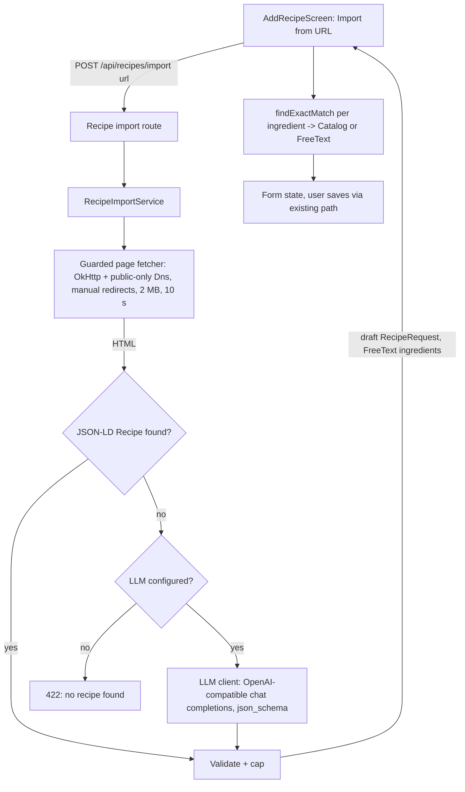

# Recipe Import from URL - Plan

## Goal Capsule

- **Objective:** A user can paste a recipe link and get a filled-in recipe form to check and save, instead of retyping it. Cookmaid never needs an LLM to run.
- **Means:** The server fetches the page and reads schema.org Recipe data. When an operator has configured one, it falls back to any OpenAI-compatible LLM. The result prefills the existing add-recipe form (KTD1, KTD2, KTD4).
- **Authority:** The Product Contract wins on behavior. KTDs win on mechanism. Project rules in `CLAUDE.md` apply throughout.
- **Execution profile:** One PR. Standard depth.
- **Stop conditions:** Stop and ask if the SSRF guard cannot be enforced with the chosen HTTP engine (KTD3), or if import would need to save recipes server-side.
- **Finishes and ships:** `ce-work`, then the usual PR flow.

---

## Product Contract

### Summary

Add "Import from URL" to the add-recipe screen. The server fetches the pasted page and extracts the recipe from schema.org structured data. If the page has none and an LLM is configured, the LLM extracts it instead. The server returns a draft that fills the form for review. Import is always available. The LLM is an optional, provider-agnostic fallback, with Cloudflare Workers AI documented only as one example setup.

### Problem Frame

Recipes found online have to be retyped ingredient by ingredient and step by step. That is the main friction in getting a collection into Cookmaid. Issue #192 asks for LLM-based parsing with generic provider support. It also asks that the LLM part can be switched off globally, so running Cookmaid never requires an LLM. Most recipe sites embed schema.org data, so import is useful even without an LLM. Cloudflare Workers AI's free tier (10,000 neurons/day, roughly 60–120 imports/day on a mid-size model) covers a household instance at no cost.

### Requirements

**Import behavior**

- R1. In create mode, the add-recipe screen offers "Import from URL". It takes a URL and fills name, description, servings, ingredients (with quantity) and steps from that page.
- R2. An imported recipe is never saved automatically. It only fills the form, and the user saves it through the existing save path.
- R3. An imported ingredient whose name exactly matches a catalog item (case-insensitive, trimmed) becomes that catalog item. Any other ingredient stays free text.
- R4. If import fails, the user sees an error and the form keeps whatever it already held. Failures include an unreachable page, no recipe found, an LLM error or an exhausted quota.

**Availability**

- R5. Import is always available and always tries schema.org structured data first. The LLM fallback runs only when the server has an LLM configured. Without one, a page with no structured data fails as "no recipe found".
- R6. The LLM is configured once per server through a generic OpenAI-compatible chat-completions endpoint (base URL, API key, model). There is no provider-specific code. Switching between Cloudflare Workers AI, OpenAI, Ollama or any other compatible provider is a config change only.

**Safety**

- R7. For user-supplied URLs, the server only fetches public http/https addresses. The operator-configured LLM endpoint is exempt (KTD4). It refuses loopback, private, link-local, CGNAT, unique-local and metadata addresses, including when reached through a redirect. Page size and fetch time are capped.
- R8. Page content is treated as untrusted. The LLM gets no tools, its output is schema-checked and length-capped before it reaches the client, and an implausible result counts as "no recipe found".

### Key Decisions

- **Import fills the form and never saves directly.** The user reviews every LLM result. Governs R2.
- **Import is always on, and the LLM is an optional fallback.** Configuring an LLM or not is the global switch for the LLM part. (session-settled: user-directed — chosen over tying the whole feature to LLM config: schema.org import needs no external service.) Governs R5.
- **The LLM provider is generic, not bound to Cloudflare.** (session-settled: user-directed — chosen over a Cloudflare-specific integration: operators can swap providers, such as OpenAI, by config.) Governs R6.
- **No fuzzy catalog matching.** Exact match reuses existing client logic, and a wrong match is worse than free text. Governs R3.

### Scope Boundaries

- Not in scope: per-user toggles, image import, import from photos or pasted text, bulk import.
- Considered and not built: **per-user rate limiting.** The worst case is one user using up the operator's daily free quota, and it shows up immediately as import errors (R4). Revisit if instances are shared beyond trusted users.
- Considered and not built: **retrying with `json_object` when a provider rejects `json_schema`.** Cloudflare's recommended models, OpenAI and Ollama all accept `json_schema`. Revisit if a supported provider needs it.

#### Deferred to Follow-Up Work

- Importing the recipe image, once recipes have images.

---

## Planning Contract

### Key Technical Decisions

- KTD1. **The server returns a draft `RecipeRequest`, and catalog matching runs on the client.** Ingredients come back as `Item.FreeText`. `AddRecipeViewModel` upgrades each one through the existing `CatalogItemRepository.findExactMatch`, the same path `addIngredientByName` uses. This avoids a new per-locale lookup on the server and keeps R3's matching rule identical to manual entry.
- KTD2. **JSON-LD first, LLM second.** jsoup (1.24.1) parses the fetched HTML. Every `script[type^=application/ld+json]` block is searched for a `Recipe` node, handling `@graph`, array `@type`, `mainEntity`, `HowToStep`/`HowToSection` instructions and number/string/array `recipeYield`. Each `recipeIngredient` string is split deterministically. A leading amount (digits, decimals, ASCII/Unicode fractions, ranges) plus an optional unit from a fixed de+en list (g, kg, ml, l, EL, TL, tbsp, tsp, cup, Prise, …) becomes `quantity`, and the trimmed rest becomes the name. A string with no leading amount keeps its full text as the name, with a null quantity. Without this split, R1's quantities and R3's catalog matching would never apply on the main path. The LLM schema returns name and quantity as separate fields. Only when no usable Recipe node exists, and an LLM is configured (KTD5), does the page's `.text()` go to the LLM, truncated to a fixed character budget. With no LLM configured, the import fails as "no recipe found". Most recipe sites carry this data, so it saves quota and is deterministic. jsoup's `Jsoup.connect` must never be used, because it would bypass KTD3.
- KTD3. **Use a dedicated SSRF-guarded fetch client: Ktor client with the OkHttp engine and a custom `Dns`.** That `Dns` rejects any non-public resolved address. OkHttp then connects only to the vetted IPs, which closes DNS rebinding, while TLS still uses the hostname. The client also runs with:
  - automatic redirects off, following redirects manually up to 5 hops and re-validating scheme and host on each one
  - `Proxy.NO_PROXY`
  - a streamed response cap of 2 MB
  - `HttpTimeout`: 10 s per request
  - the public-address predicate applied directly to the URL host whenever it is an IP literal, including bracketed IPv6, on the first request and on every redirect hop, because OkHttp resolves IP literals itself and never calls `Dns` for them

  The Java engine has no DNS hook, and CIO's resolver hook is under-documented. Explicit range checks cover CGNAT `100.64/10`, IPv6 ULA `fc00::/7`, IPv4-mapped IPv6 and NAT64, which the JDK predicates miss (OWASP SSRF cheat sheet).
- KTD4. **The LLM client is a separate, unguarded, provider-agnostic Ktor client.** It uses only the standard OpenAI chat-completions contract, with no provider SDKs and no provider-specific branches (R6). It posts to `{llm.base-url}/chat/completions` with `Authorization: Bearer {llm.api-key}`, `model`, and `response_format: json_schema` (OpenAI strict-mode schema). The system prompt also describes the JSON, marks the page text as untrusted data, and allows an explicit "no recipe" answer. It installs `HttpTimeout` with a 60 s request/socket timeout. Without it, OkHttp's default 10 s read timeout would cut off non-streaming generation on slower models. It has to be separate because a legitimate `base-url` may be a private address, such as a LAN Ollama, and the KTD3 guard would block it.
- KTD5. **Config keys are `llm.base-url`, `llm.api-key` and `llm.model`, with env vars `LLM_BASE_URL`, `LLM_API_KEY` and `LLM_MODEL`, all defaulting to empty.** The LLM fallback is enabled only when base URL and model are both non-blank, read with `propertyOrNull`. This deliberately differs from the `property()` rule for security config, because absence is a valid state here (R5). The API key may be blank for a keyless local Ollama. Docs show OpenAI, Ollama and Cloudflare as example setups. The Cloudflare example uses base URL `https://api.cloudflare.com/client/v4/accounts/<account-id>/ai/v1` with model `@cf/google/gemma-4-26b-a4b-it` (256k context, about 80–165 neurons per import). Avoid `@cf/qwen/qwen3-30b-a3b-fp8`, which is deprecated on 2026-11-15.
- KTD6. **There is a single endpoint, `POST /api/recipes/import` with `{ "url": … }`, which returns the draft.** It needs no availability endpoint, because import is always on (R5). It is registered before `route("/{recipeId}")` (route-ordering rule). Failures throw a dedicated `RecipeImportException`, which StatusPages maps to 422 with an empty body. Messages must not echo page content or URLs, per the StatusPages rule in `CLAUDE.md`.
- KTD7. **Output validation lives in the service.** A result needs a non-blank name and at least one ingredient or step to be accepted. Caps apply:
  - name: 200 characters
  - description: 2,000 characters
  - each ingredient or step: 500 characters
  - at most 100 ingredients and 100 steps
  - servings: 1–100, otherwise null

  Values over a cap are truncated. Results without the required name and content are rejected. HTML entities and tags in JSON-LD strings are decoded or stripped through jsoup.

### High-Level Technical Design

### Assumptions

- Ktor 3.6.1 ships `ktor-client-okhttp` with OkHttp 5.x and exposes `preconfigured`/`config { dns(...) }` for a custom `Dns`. Verify at implementation.
- Workers AI with `@cf/google/gemma-4-26b-a4b-it` honors `json_schema`. Cloudflare says adherence is not guaranteed, so KTD7 validation is the backstop.

---

## Implementation Units

### U1. Guarded page fetcher and server dependencies

- **Goal:** A server component that fetches a user URL under the KTD3 rules and returns the HTML or fails cleanly.
- **Requirements:** R7
- **Dependencies:** none
- **Files:**
  - `gradle/libs.versions.toml` (add `ktor-clientOkhttp`, `jsoup`, `ktor-clientMock` in their groups)
  - `server/build.gradle.kts`
  - `server/src/main/kotlin/io/github/fgrutsch/cookmaid/recipe/importer/PageFetcher.kt` (new)
  - `server/src/main/kotlin/io/github/fgrutsch/cookmaid/common/ktor/Errors.kt` (add `RecipeImportException`)
  - `server/src/test/kotlin/io/github/fgrutsch/cookmaid/recipe/importer/PageFetcherTest.kt` (new)
- **Approach:**
  1. Write the public-address predicate as a pure function over `InetAddress` so it can be unit-tested without the network.
  2. Wire the predicate into a custom OkHttp `Dns` that throws when any resolved address is non-public. Also apply it directly to IP-literal hosts before each request (KTD3).
  3. Follow redirects manually, checking hop count, scheme and host each time. Read the body with a byte cap.
  4. Convert every failure into `RecipeImportException` (created here, mapped in U3).
- **Patterns to follow:** typed exceptions in `server/src/main/kotlin/io/github/fgrutsch/cookmaid/common/ktor/Errors.kt`. Keep the logger inside the class.
- **Test scenarios:**
  - The predicate rejects `127.0.0.1`, `10.0.0.1`, `172.16.0.1`, `192.168.1.1`, `169.254.169.254`, `100.64.0.1`, `0.0.0.0`, `::1`, `fc00::1`, `fe80::1` and `::ffff:127.0.0.1`.
  - The predicate accepts `93.184.216.34` and `2606:4700::1`.
  - Fetching `http://localhost:<port>/` fails with `RecipeImportException`, with an embedded test server running on that port.
  - Fetching the IP literals `http://127.0.0.1:<port>/`, `http://[::1]:<port>/` and `http://169.254.169.254/` fails with `RecipeImportException`.
  - Fetching `ftp://example.com` or `file:///etc/passwd` is rejected without a network call.
  - These scenarios use a test `Dns`/predicate seam that treats the embedded server as public, so the limit under test is what fails rather than the guard:
    - a redirect from an allowed host to a private hostname or IP literal is rejected
    - a body over 2 MB is rejected
    - more than 5 redirects are rejected
- **Test seam:** unit tests on the predicate and fetcher catch the guard logic. They don't prove behavior against real public DNS, which stays a manual check.
- **Verification:** All scenarios pass. The guarded client is the only client that reaches user URLs.

### U2. Recipe extraction service (JSON-LD + LLM)

- **Goal:** Turn fetched HTML into a validated draft `RecipeRequest`.
- **Requirements:** R1, R4, R6, R8
- **Dependencies:** U1
- **Files:**
  - `server/src/main/kotlin/io/github/fgrutsch/cookmaid/recipe/importer/JsonLdRecipeExtractor.kt` (new)
  - `server/src/main/kotlin/io/github/fgrutsch/cookmaid/recipe/importer/LlmRecipeExtractor.kt` (new)
  - `server/src/main/kotlin/io/github/fgrutsch/cookmaid/recipe/importer/RecipeImportService.kt` (new)
  - `server/src/test/kotlin/io/github/fgrutsch/cookmaid/recipe/importer/JsonLdRecipeExtractorTest.kt` (new)
  - `server/src/test/kotlin/io/github/fgrutsch/cookmaid/recipe/importer/LlmRecipeExtractorTest.kt` (new)
  - `server/src/test/kotlin/io/github/fgrutsch/cookmaid/recipe/importer/RecipeImportServiceTest.kt` (new)
  - test HTML fixtures under `server/src/test/resources/import/`
- **Approach:**
  - JSON-LD extraction walks `kotlinx.serialization` `JsonElement`s per KTD2.
  - The LLM extractor sends the KTD4 request with a `ktor-client-mock`-testable engine.
  - The service orchestrates fetch, then JSON-LD, then LLM, then KTD7 validation, with ingredients as `Item.FreeText`.
  - It logs at `info` on success (userId, host, which path won) and at `debug` on rejection, never logging page content.
- **Patterns to follow:** service shape in `server/src/main/kotlin/io/github/fgrutsch/cookmaid/recipe/RecipeService.kt`, and `UserId` as the identity parameter.
- **Test scenarios:**
  - JSON-LD: a top-level `Recipe` object fills every field.
  - JSON-LD: a Recipe inside `@graph` alongside `WebPage`/`Organization` is found.
  - JSON-LD: `@type: ["Recipe","NewsArticle"]` is found.
  - JSON-LD: instructions as a plain string, a `HowToStep` list, and `HowToSection` with `itemListElement` all produce a flat list of steps.
  - JSON-LD: `recipeYield` given as `4`, `"4 servings"` and `["4","4 portions"]` all give servings = 4.
  - JSON-LD: a malformed JSON-LD block is skipped and the next block is tried.
  - JSON-LD: entity-encoded strings (`&amp;`, `
`) come back as plain text.
  - Ingredient split: `"200 g Butter"` gives name `Butter` and quantity `200 g`.
  - Ingredient split: `"1/2 TL Salz"` gives name `Salz` and quantity `1/2 TL`.
  - Ingredient split: `"½ cup sugar"` gives name `sugar` and quantity `½ cup`.
  - Ingredient split: `"Salz und Pfeffer"` keeps the full text as the name, with a null quantity.
  - LLM: a mock engine delay beyond the timeout gives a failure.
  - LLM: the request body carries the model, `response_format.type = json_schema`, and page text wrapped as untrusted data.
  - LLM: a valid JSON response maps to a draft.
  - LLM: a "no recipe" answer gives a failure.
  - LLM: a non-2xx response (quota exhausted, 429) gives a failure.
  - LLM: non-JSON content gives a failure.
  - Service: a page with JSON-LD never calls the LLM (the mock engine records zero calls).
  - Service: a page without JSON-LD calls the LLM once when an LLM is configured.
  - Service: a page with JSON-LD imports successfully when no LLM is configured.
  - Service: a page without JSON-LD fails as "no recipe found" when no LLM is configured, with no LLM call.
  - Service: a result with a blank name is rejected.
  - Service: 150 ingredients are capped to 100, and a 1,000-character step is truncated to 500.
- **Verification:** All scenarios pass, and no extractor depends on the network.

### U3. Import endpoints, config and wiring

- **Goal:** Expose import over the API, with the optional LLM fallback wired from config.
- **Requirements:** R1, R4, R5, R6
- **Dependencies:** U2
- **Files:**
  - `core/src/commonMain/kotlin/io/github/fgrutsch/cookmaid/recipe/RecipeImport.kt` (new: request `{url}`)
  - `server/src/main/kotlin/io/github/fgrutsch/cookmaid/recipe/RecipeModule.kt`
  - StatusPages configuration file
  - `server/src/main/resources/application.yaml`
  - `server/src/test/kotlin/io/github/fgrutsch/cookmaid/support/TestConfig.kt`
  - `server/src/test/kotlin/io/github/fgrutsch/cookmaid/recipe/RecipeImportRoutesTest.kt` (new)
  - `dev/docker-compose.yml`
  - `demo/docker-compose.yml`
  - `CLAUDE.md` (env var list and a short Key Patterns entry for the import and SSRF rules)
- **Approach:**
  - Add the config keys per KTD5.
  - Register the Koin singles in the recipe module, with the guarded fetcher and the LLM client as separate instances.
  - Register the route before `/{recipeId}` (KTD6). Bind the LLM extractor only when KTD5's config is present, and let the service treat its absence as "no fallback".
  - Map `RecipeImportException` to 422 at `debug` level.
  - The request DTO defaults `url` to `""`, and the route calls `require(url.isNotBlank())`. A missing or blank URL then becomes `IllegalArgumentException`, which maps to 400. Otherwise Ktor's `BadRequestException` would fall through to the 500 catch-all.
  - In `TestConfig`, add empty LLM entries.
- **Patterns to follow:** routes and Koin in `server/src/main/kotlin/io/github/fgrutsch/cookmaid/recipe/RecipeModule.kt`, and `testApplication` with `TestJwt` as in the existing recipe route tests.
- **Test scenarios:**
  - With the service stubbed to succeed, `POST /api/recipes/import` returns 200 with a draft.
  - The app starts and the import route responds with LLM config empty, so the server needs no LLM.
  - A failing import returns 422 with no page content in the body.
  - A missing or blank `url` returns 400.
  - Without a token, the route returns 401.
- **Verification:** Route tests pass, and the server starts with and without the `LLM_*` env vars.

### U4. Client: import action in the add-recipe form

- **Goal:** The user imports a URL from the add-recipe screen and gets a prefilled, catalog-matched form.
- **Requirements:** R1, R2, R3, R4, R5
- **Dependencies:** U3
- **Files:**
  - `app/shared/src/commonMain/kotlin/io/github/fgrutsch/cookmaid/ui/recipe/RecipeClient.kt`
  - `app/shared/src/commonMain/kotlin/io/github/fgrutsch/cookmaid/ui/recipe/RecipeRepository.kt`
  - `app/shared/src/commonMain/kotlin/io/github/fgrutsch/cookmaid/ui/recipe/edit/AddRecipeContract.kt`
  - `app/shared/src/commonMain/kotlin/io/github/fgrutsch/cookmaid/ui/recipe/edit/AddRecipeViewModel.kt`
  - `app/shared/src/commonMain/kotlin/io/github/fgrutsch/cookmaid/ui/recipe/edit/AddRecipeScreen.kt`
  - `app/shared/src/commonMain/kotlin/io/github/fgrutsch/cookmaid/ui/recipe/edit/AddRecipeComponents.kt`
  - string resources (de + en)
  - `FakeRecipeRepository` under `app/shared/src/commonTest/`
  - `app/shared/src/commonTest/kotlin/io/github/fgrutsch/cookmaid/ui/recipe/edit/AddRecipeViewModelTest.kt`
- **Approach:**
  1. An `ImportFromUrl(url)` event sets a loading flag, calls the repository, maps each ingredient through `findExactMatch` (KTD1), and applies the draft to state the way edit-mode preload does.
  2. On failure, `onError` shows the error effect and leaves state untouched (R4).
  3. The UI is a top-bar action that opens a dialog with a single URL field. It shows in create mode only. While loading, the field and confirm button are disabled and a progress indicator shows, so a double submit can't spend quota twice. On success the dialog closes. On failure it stays open with the URL kept.
- **Patterns to follow:**
  - edit-mode preload in `AddRecipeViewModel`
  - `launch {}` / `onError` in `MviViewModel`, with no extra logging in `onError`
  - `CancellationException` rethrow rule for any new catch
  - `IllegalStateException` in fakes
- **Test scenarios:**
  - A successful import fills name, description, servings and steps.
  - An ingredient named "Butter" with a catalog item "butter" becomes `Item.Catalog`. "Dragonfruit powder" with no match stays `Item.FreeText`.
  - Ingredient quantities are preserved.
  - A failed import emits the error effect, keeps the existing form state, and clears the loading flag.
  - Importing while the form already has data replaces it.
- **Verification:** ViewModel tests pass. Running manually against a local server fills the form from a real recipe URL.

### U5. User-facing docs

- **Goal:** Users and operators know the feature exists and how to enable it.
- **Requirements:** R5, R6
- **Dependencies:** U3
- **Files:**
  - `docs/faq.md` ("How do I import a recipe from a website?" under Recipes)
  - `README.md` (optional `LLM_*` env vars, with OpenAI, Ollama and Cloudflare Workers AI example setups and the Workers AI free-tier note)
- **Approach:** Explain that import works on sites with recipe structured data and, when the operator configured an LLM, on other sites too. Results must be reviewed before saving.
- **Test expectation:** none — documentation only.
- **Verification:** The FAQ entry and README env-var section are present and match KTD5 key names.

---

## Verification Contract

| Gate | Command | Proves |
|---|---|---|
| Server tests | `mise exec -- ./gradlew :server:test` | U1–U3 |
| Core tests | `mise exec -- ./gradlew :core:allTests` | Shared DTOs compile on all targets |
| App tests | `mise exec -- ./gradlew :app:shared:allTests` | U4 |
| Lint | `mise exec -- ./gradlew detektAll` | Project style rules |
| Manual | Run `:server:run` without `LLM_*` and import a JSON-LD site. Then set `LLM_*` to any OpenAI-compatible provider and import a site without JSON-LD | End-to-end behavior, both modes, real DNS guard |

## Definition of Done

- All gates in the Verification Contract pass.
- With no `LLM_*` config, the server starts and schema.org import works. No code references a specific LLM provider.
- No code path fetches a user-supplied URL except through the guarded fetcher.
- KDoc on new public classes and methods per `CLAUDE.md`.
- `docs/faq.md`, `README.md`, both docker-compose files and the `CLAUDE.md` env list are updated.
- No abandoned or experimental code remains in the diff.

---

## Appendix

### Sources

- Cloudflare Workers AI pricing (free 10,000 neurons/day): https://developers.cloudflare.com/workers-ai/platform/pricing/
- Workers AI JSON mode (no adherence guarantee): https://developers.cloudflare.com/workers-ai/features/json-mode/
- Workers AI limits (300 req/min): https://developers.cloudflare.com/workers-ai/platform/limits/
- OWASP SSRF Prevention Cheat Sheet: https://cheatsheetseries.owasp.org/cheatsheets/Server_Side_Request_Forgery_Prevention_Cheat_Sheet.html
- OWASP LLM01 Prompt Injection: https://genai.owasp.org/llmrisk/llm01-prompt-injection/
- schema.org Recipe: https://schema.org/Recipe and Google recipe structured data: https://developers.google.com/search/docs/appearance/structured-data/recipe
- Existing client matching: `CatalogItemRepository.findExactMatch`, used by `AddRecipeViewModel.addIngredientByName`
